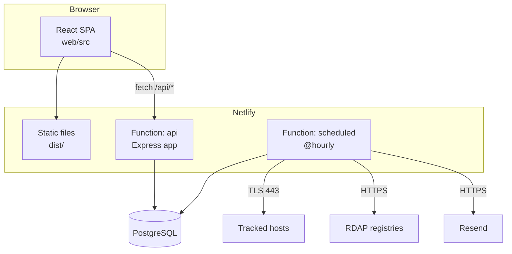

# Architecture

This document explains how Lapse Radar is put together and why. It describes the code as it is today.

## Shape of the system

| Folder               | Responsibility                                                                                                                              |
| -------------------- | ------------------------------------------------------------------------------------------------------------------------------------------- |
| `web/`               | React single-page app (routing, forms, dashboard, themes). No business rules beyond display.                                                |
| `server/`            | The Express app (`app.ts`), auth, items, alerts and settings routers, the checkers (`checks/`), the alert engine, email, the scheduled run. |
| `shared/`            | Pure functions used by both sides, e.g. days remaining and the status bands (`expiry.ts`).                                                  |
| `netlify/functions/` | Thin adapters: `api.ts` wraps the Express app, `scheduled.ts` calls `runScheduled`.                                                         |
| `migrations/`        | Plain SQL files applied in order by `server/db/migrate.ts`.                                                                                 |
| `e2e/`               | Playwright tests against the dev server (in-memory database).                                                                               |

## Why these choices

- **Express inside one Netlify Function** (via `serverless-http` and `@netlify/aws-lambda-compat`): one familiar app instead of one function per route, and the same app runs under Vite in development, so a single command starts everything.
- **Postgres, no ORM.** The data is relational and a few queries (alert creation, quota, rate limits) are clearest as SQL. The `Db` interface (`query`, `transaction`, `close`) has two drivers: `pg` for Neon and PGlite for development and tests. The trade-off: PGlite and `pg` can differ in rare details, so production behaviour was checked against real Postgres where it mattered (for example the advisory lock).
- **Everything time-related is UTC.** Dates are `timestamptz`. "Days left" is the number of whole days rounded up, computed in one pure function that is tested at daylight-saving boundaries.

## Data model

`users` · `sessions` · `items` · `alerts` · `rate_limits` · `email_quota` (+ `schema_migrations`).

- `items` belong to a user (`user_id`), have a kind (`tls`, `domain`, `manual`), a host for automatic kinds, `expires_at`, check status and `next_check_at`. A partial index serves the "due" query; `(user_id, kind, host)` is unique.
- `alerts` carry the item, the threshold in days and a **snapshot of the expiry date**. `unique (item_id, threshold_days, expiry_snapshot)` is the idempotency key. A composite foreign key `(user_id, item_id)` makes it impossible to attach an alert to another user's item, and deleting an item or user cascades.
- Sessions store only the SHA-256 of the cookie token.

## Request flow

1. The browser calls `/api/...` with its cookie. `app.ts` first sets security headers and refuses writes whose `Origin` is another site.
2. A router runs `requireUser` (looks up the session hash), which puts the user on `res.locals`. Every later query includes that `user_id`; a resource of another user is indistinguishable from a missing one (404).
3. Input is validated with zod; errors are returned as `{ error: { code, message } }` without internals. The demo account is refused on every write.

## Alerts: the central idea

`evaluateAlerts` (`server/alerts.ts`) is one `insert ... select ... on conflict do nothing`. For each item it picks the smallest threshold (the user's list plus 0 for "expired") that the item's days remaining has reached, and inserts `(item, threshold, expiry_snapshot)`.

- **Idempotent and race-safe:** running it twice, or concurrently, creates nothing new, because of the unique key.
- **One alert for a late item:** an item first seen 5 days before expiry gets the 7-day alert only.
- **Renewal re-arms:** a new expiry date is a new key, so the thresholds fire again.
- It runs in the hourly job and, for the affected user only, right after an item is created, edited or checked, so alerts show up immediately.

## The hourly run

`runScheduled` (`server/scheduled.ts`) in one transaction:

1. `pg_try_advisory_xact_lock`: if another run holds it, return at once.
2. `runDueChecks`: up to 50 due items, 8 at a time, no new check after 20 s of a 25 s budget; each check ends with the item's new status and the next check time (24 h after success, 6 h after an error, 7 days for a TLD without RDAP).
3. `evaluateAlerts` for everyone.
4. `sendPendingEmails`: oldest first, at most 20 per run, 80 a day overall and 5 per user per day, none after 28 s; failures are stored on the alert.

Known compromise (also in the README): all of this shares one transaction, so a platform kill before the commit loses the batch and may repeat an email.

## Outgoing connections and SSRF

User-supplied host names are the main security risk. `checks/ssrf.ts` resolves the name and rejects the host if **any** answer is in a blocked IPv4 range (private, loopback, link-local including the metadata address, CGNAT, multicast, documentation, reserved). IPv6 is an allow-list: only global unicast (`2000::/3`) passes, minus Teredo, 6to4 and documentation ranges, which also rules out loopback, unique-local, link-local and IPv4-mapped addresses. `checks/tls.ts` then connects to the resolved IP (no second lookup, so no rebinding window) with the host as SNI, on port 443 only, with a 5 s limit. `checks/rdap.ts` reads a cached IANA bootstrap file from a fixed URL and never follows redirects.

## Security headers and policy

API responses are `no-store` with `nosniff` and `no-referrer`. `netlify.toml` adds a CSP that allows only same-origin resources (the bundle has no inline script or style), `frame-ancestors 'none'` and HSTS.

## Testing strategy

- **Unit and integration (Vitest):** run against PGlite with the real migrations; the checkers take injected network functions, so they are tested with fixtures. A live mode (`LIVE_CHECKS=1`) makes one real call per checker.
- **End to end (Playwright):** the real dev server with an in-memory database; each test uses its own client IP so rate limits do not interfere.
- **Isolation matrix:** two users against every route, expecting 404 for the other's ids.
- **What only the real deployment revealed:** a UTF-8 BOM in `package.json` and a test file deployed as a function. Neither was visible locally, so the deploy gate exercises edge cases on the real URL.

## Deployment

Static files and functions on Netlify, database on Neon, email through Resend. Production is built from the `release` branch only; `main` is the development branch and CI runs on both. Scheduled functions exist only on the published deployment.
