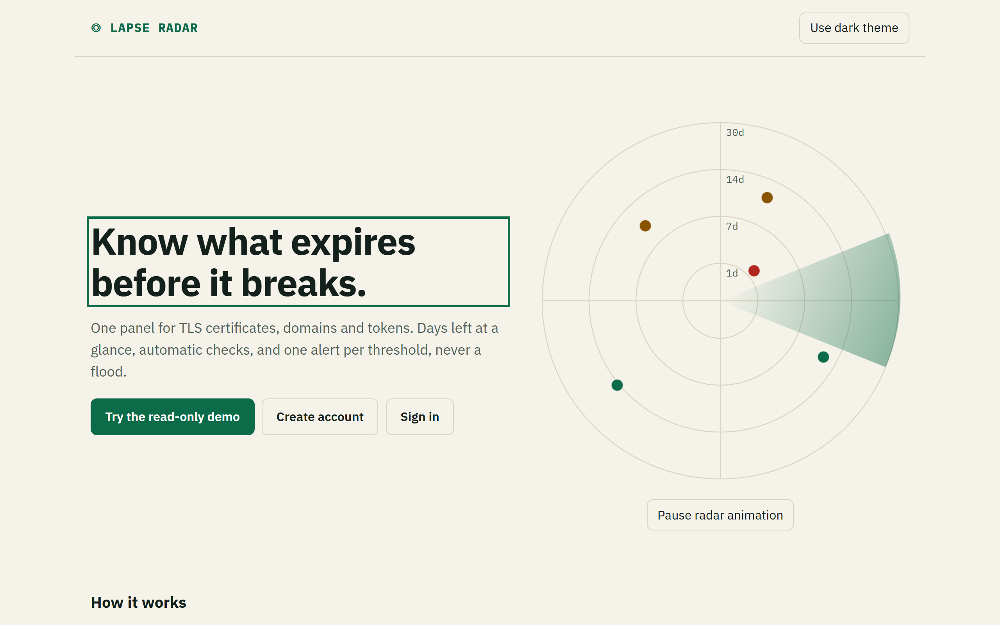
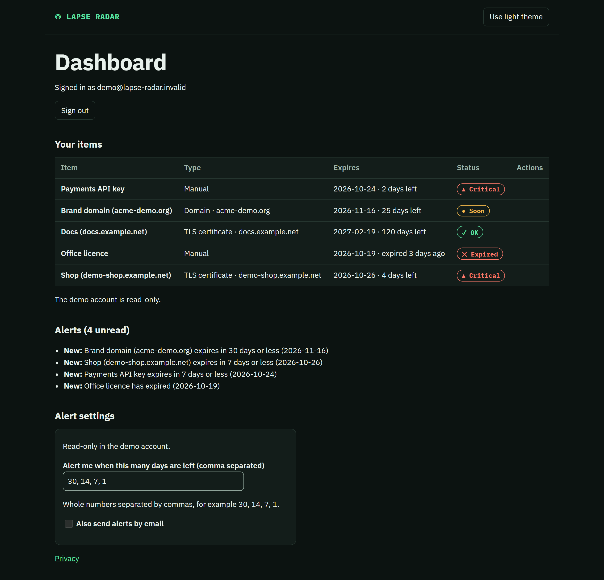
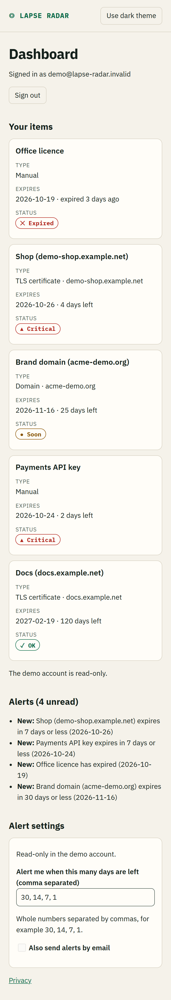
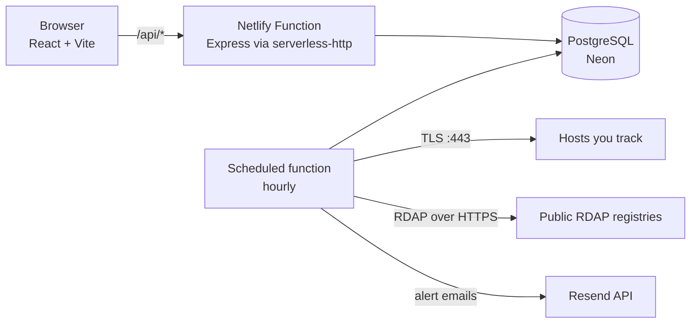

# Lapse Radar

[](https://github.com/jmartintechit-blip/Lapse-Radar/actions/workflows/ci.yml)


**Know what expires before it breaks.** Lapse Radar is a small multi-user dashboard that watches TLS certificates, domain registrations and anything else with a date (tokens, licences) and sends **one alert per item, threshold and expiry date**, in the app and by email.

> A portfolio project built with AI assistance. It is a demo-scale service, not a commercial product: see [Limitations](#limitations).





## What it does

- **Three kinds of items.** A host name for its TLS certificate, a domain name (registration expiry through RDAP), or a manual item with a label and a date.
- **Automatic checks.** An hourly scheduled function checks the items that are due (TLS: always; domains: when the TLD publishes RDAP). "Check now" works on demand, once per minute per item.
- **Alerts without noise.** Thresholds default to 30, 14, 7 and 1 days, plus expiry. An alert exists once per (item, threshold, expiry date). An item added when it is already 5 days out gets one alert (the 7-day one), not four. Renewing an item changes its expiry date, so the alerts arm again.
- **Inbox and email.** Alerts appear in the dashboard; emails go out through [Resend](https://resend.com) when a key is configured.
- **Read-only demo account** with fictional data, **account deletion** that removes every row of the user, and a plain-language [privacy page](web/src/Privacy.tsx).
- **Accessible and responsive.** Light and dark themes, keyboard operable, status never shown by colour alone, rows become cards on narrow screens. Lighthouse accessibility measured at 100 on the public pages and the demo dashboard (see [Quality](#quality)).



## How it works



- **One codebase, one `package.json`.** `web/` (React), `server/` (Express app, checks, alerts, email), `shared/` (pure expiry maths), `netlify/functions/` (thin adapters), `migrations/` (plain SQL), `e2e/` (Playwright).
- **No ORM.** A tiny `Db` interface with two drivers: `pg` in production and [PGlite](https://pglite.dev) (Postgres in WebAssembly) for local development and tests, so `npm run dev` needs no database.
- **The hourly run** (`server/scheduled.ts`) takes a transaction-level advisory lock so two runs never overlap, checks up to 50 due items with concurrency 8 inside a 25 s budget, creates alerts with a single SQL statement, then sends pending emails.
- **Sessions** are random tokens in an `HttpOnly`, `Secure`, `SameSite=Lax` cookie; only the SHA-256 of the token is stored. Passwords use scrypt from `node:crypto`.

## Security design

| Risk                           | What the code does                                                                                                                                                                                                                                                                            |
| ------------------------------ | --------------------------------------------------------------------------------------------------------------------------------------------------------------------------------------------------------------------------------------------------------------------------------------------- |
| SSRF through "check this host" | Resolves DNS first and refuses private, loopback, link-local, metadata, CGNAT and other reserved IPv4/IPv6 ranges (if any answer is non-public the host is refused). Connects to the resolved IP with SNI, port 443 only, 5 s timeout. RDAP uses a fixed IANA bootstrap URL and no redirects. |
| Reading other users' data      | Every query filters by `user_id`; a foreign id is a 404; alerts reference items through a composite foreign key. Covered by two-user tests.                                                                                                                                                   |
| Abuse                          | Rate limits kept in Postgres (sign-up, login per IP and per IP+email, writes per user), a cap of 100 users and 10 items per user, 80 emails a day overall and 5 per user. IPv6 clients are limited by /64 prefix.                                                                             |
| CSRF / XSS                     | `SameSite=Lax`, an `Origin` check on writes, JSON-only bodies, a CSP without inline code, `nosniff`, no `dangerouslySetInnerHTML`.                                                                                                                                                            |
| Information leaks              | Generic error bodies, login that does not reveal which emails exist, errors from Resend reduced to a status code.                                                                                                                                                                             |

The code was reviewed by a security-focused pass; findings that were not fixed are listed in [Limitations](#limitations).

## Run it locally

Requires Node.js 22 or newer.

```bash
npm install
npm run dev        # http://localhost:5173, in-process Postgres, data kept in .data/
```

Then press "Try the read-only demo", or create an account.

```bash
npm run check      # lint, type-check, format check, unit tests
npm run e2e        # Playwright end-to-end tests (uses the Chrome installed locally; CI installs Chromium)
```

Local checks never touch the network unless you run the live tests: `LIVE_CHECKS=1 npm test` makes real TLS and RDAP calls.

### Configuration for a real deployment

Set these as environment variables (never commit them):

| Variable         | Needed | Purpose                                                                             |
| ---------------- | ------ | ----------------------------------------------------------------------------------- |
| `DATABASE_URL`   | yes    | PostgreSQL connection string (Neon works). Apply the schema with `npm run migrate`. |
| `RESEND_API_KEY` | no     | Without it alerts stay in the app and unsent emails wait until a key exists.        |
| `EMAIL_FROM`     | no     | Sender address; defaults to Resend's shared `onboarding@resend.dev`.                |

`netlify.toml` builds the site and sets the security headers. Production is served from the `release` branch.

## Quality

- **Tests:** unit tests for the pure expiry maths, SSRF rules, TLS/RDAP parsing (with fixtures), the alert engine (renewal, single threshold, expired), the scheduled run and lock, email quota, auth, isolation between users and account deletion; Playwright tests for sign-up, items, alerts, settings, the demo, deletion, keyboard use, focus and theme.
- **CI:** GitHub Actions runs `npm run check` and the E2E suite on pushes to `main` and `release` and on pull requests.
- **Lighthouse** (Chrome headless, mobile profile, production build served locally without the hosting headers, measured 2026-10-22): accessibility 100 on the home, sign-in, sign-up and privacy pages and on the demo dashboard; SEO 100 on the home page. Re-measure on the deployed site before relying on these numbers.
- Not tested with a real screen reader.

## Limitations

Honest list, on purpose:

- **Demo scale.** At most 100 accounts, 10 items per account. The free tiers it targets (Netlify, Neon, Resend) set the ceiling, and Netlify's free credits are shared across a whole account.
- **Email.** Without a verified sending domain Resend only delivers to the account owner's own address, so alert emails to other users fail (and are recorded as failed). Sign-up does not verify email addresses. Failed sends are not retried.
- **RDAP coverage.** Registry expiry is read automatically only for TLDs listed in the IANA RDAP bootstrap; for the others (for example `.es`, `.io`, `.eu`, `.de` at the time of writing) use a manual item. Some registries do not expose an expiry event.
- **The scheduled run** shares one database transaction for checks, alerts and emails. If the platform kills it before the commit, the work is lost and an email may be sent twice. A "check now" on an item that the hourly run is checking waits for it.
- **Scrypt cost** is N=2^15, r=8, p=1, below the highest OWASP recommendation; the session cookie has no `__Host-` prefix.
- **Sign-up reveals** whether an email is already registered (it returns a conflict), a usability trade-off.
- **A few unauthenticated edge-case endpoints** under `/api/_edge/` exist to exercise the serverless adapter; they echo bytes only.
- Cron-style behaviour only exists on the published deployment: the scheduled function cannot be run locally.

## Privacy

What is stored and who processes it is described in plain language on the in-app [privacy page](web/src/Privacy.tsx). Short version: email, password hash, your items and alerts, hashed session tokens, and short-lived abuse counters; no analytics or advertising cookies.

## Project status

Working toward a first release. See the commit history for the build log. This README states only what the code does today.

## License

[MIT](LICENSE).
